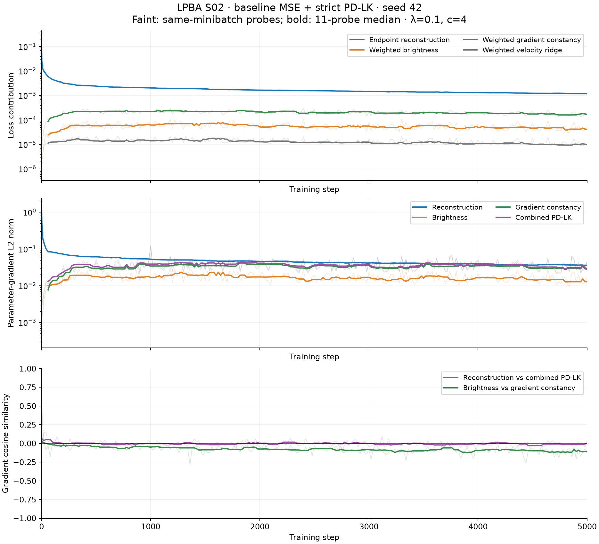
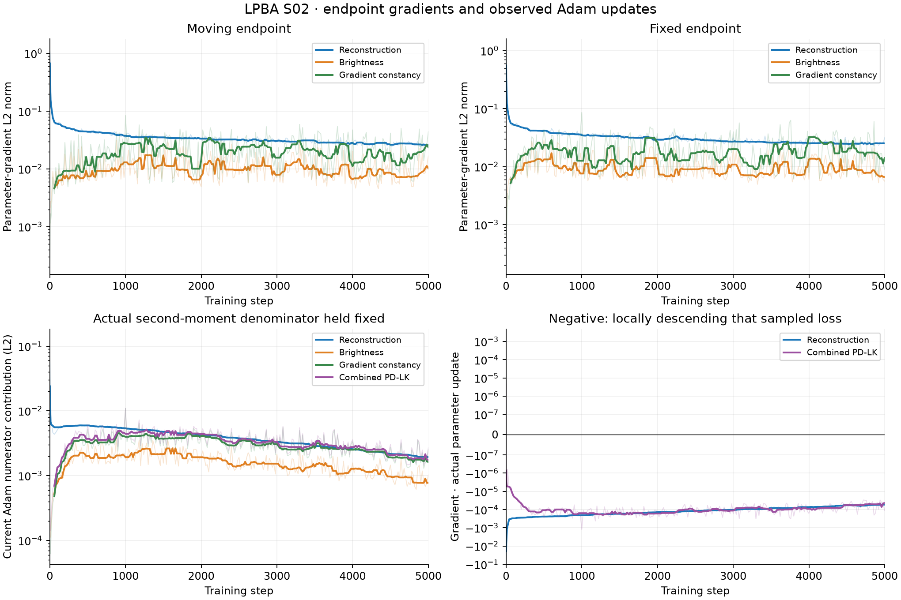

# Baseline PD-LK gradient dynamics: LPBA S02, seed 42

One authorized 5,000-step fit used the maintained LPBA MSE+strict-PD-LK preset:
width 256, four SIREN layers, shared initialization, 32,768 endpoint samples,
4,096 PD-LK sites, lambda=.1, c=4, eta=1e-6, rho=0, detached local velocity,
the existing Adam/LR schedule and global norm-1 clipping. No new objective was
introduced. The maintained trainer and total backward were used without edits.
The run took 40.79 s including diagnostic overhead and final endpoint evaluation;
this is not a controlled timing comparison. Endpoint PSNR was 32.194/32.427 dB
(moving/fixed), passing the 25 dB gate. No recovery was requested or run.

## What was measured

At steps 1, 2, 5, 10 and every 20 steps thereafter (254 probes), the same training
minibatches and interpolation time were used to evaluate:

\[
R=\mathrm{MSE}_M+\mathrm{MSE}_F,\quad
B=\lambda\langle(q+g^Tv^*)^2\rangle,\quad
D=\lambda c\langle\|m+Hv^*\|^2\rangle,\quad
V=\lambda\eta\langle\|v^*\|^2\rangle.
\]

Component parameter gradients hold the shared optimal local velocity v* fixed,
matching the maintained detached-solve convention. V has a nonzero scalar value
but zero direct parameter gradient under that convention. This does not mean
eta is irrelevant: it changes v* and therefore changes B and D and their
gradients. Individual components are not separately re-minimized.

Gradient probes use separate eager graphs and `autograd.grad`, preserve the RNG
stream and do not populate parameter `.grad`. Normal training retains its compiled
derivatives and one Adam update per step. The reconstructed component gradient was
checked against the actual clipped gradient supplied to Adam: median relative
error 2.77e-5, maximum 9.76e-4 (below .1%), consistent with the observed eager vs
compiled floating-point differences. This is not a bitwise trajectory-equivalence
certificate. All probe values were finite. Per-network and per-layer norms are
retained in the ignored CSV. Scripts are retained with the ignored evidence;
no diagnostic hooks were added to maintained training code.

## Observed balance

All norms below include the actual objective coefficients and combine both endpoint
networks. Entries are phase medians; the final column counts sampled probes, not
all training steps.

| Steps | Reconstruction norm | Brightness norm | Gradient-constancy norm | Combined PD-LK norm | PD-LK norm exceeds reconstruction |
|---|---:|---:|---:|---:|---:|
| 1–100 | .200 | .00525 | .00385 | .00657 | 0% |
| 101–1,000 | .0596 | .0171 | .0299 | .0330 | 4.4% |
| 1,001–2,000 | .0480 | .0191 | .0350 | .0404 | 20.0% |
| 2,001–5,000 | .0404 | .0156 | .0335 | .0358 | 33.3% |

Reconstruction dominates initially. Shared initialization makes the image path
time-independent at the first step, so PD-LK starts at zero; it grows as the
endpoint networks separate. After step 100, D exceeds B at every sampled probe.
Late in training, reconstruction and combined PD-LK are comparable: the median
PD-LK/reconstruction norm ratio is .878, with 10th/90th percentiles .648/1.274.
The dominant one switches between 76 of the 149 adjacent late probes. This is
stochastic variation across observations 20 updates apart, not evidence of a
periodic alternation or a measurement of every intervening step.

Scalar loss size does not reflect gradient balance. Late-phase median R is
.00138, versus B=.0000506 and D=.000191, yet D's parameter-gradient norm is
already about .83 of reconstruction's phase-median norm. The gradient component
therefore has substantial influence despite a smaller loss value.

Global reconstruction/PD-LK gradients are nearly orthogonal: late median cosine
-.0074, with 10th/90th percentiles -.0425/.0278. Brightness and differential
gradients have mild opposition (median cosine -.0882), rather than strong
cancellation. Both endpoint networks show the same broad balance. Late median
moving/fixed norms are .0297/.0270 for R, .00944/.00787 for B and .0201/.0170
for D. Among layer blocks, the first width-to-width sine layer has the largest
L2 norms; this statistic also reflects its parameter count.

## Adam and clipping

The actual optimizer update was observed at each probe. Reconstruction and
combined PD-LK both had negative directional derivatives along the actual update
at every probe after step 100: locally, those steps pointed downhill for both
sampled objectives. This is a first-order check, not a post-update loss evaluation
or a guarantee about unsampled data. Only step 2 had a positive sampled PD-LK
directional derivative. Global clipping was active at sampled steps 1, 2 and 5,
and not at later probes; clipping does not explain the late balance.

For additional context, each current component gradient was passed through the
actual updated Adam second-moment denominator, holding that denominator fixed.
Late median current-numerator contribution norms are .00288 for reconstruction
and .00286 for combined PD-LK. They are effectively balanced by this measure.
Historical momentum contributes too (late median norm .00836); it cannot be
assigned to individual objectives from sparse probes. These conditional
numerator contributions are not causal optimizer ablations, independent Adam
steps, or additive percentages of the final update, because the denominator
itself depends on the combined gradient.

This single-case result supports a stable balance: early reconstruction fitting,
then comparable reconstruction and PD-LK gradient pressure with the differential
term providing most of PD-LK's gradient magnitude. It does not establish the same
behavior on other pairs or for the experimental replacement objectives.

Compact statistics are in [JSON](pdlk_gradient_diagnostic_20261111.json). Full
scalar traces, final endpoint weights, observer scripts and standalone PDFs are
in ignored `results/pdlk_gradient_diagnostic/20261111_s02/`. Datasets and prior
artifacts were preserved; no deformation maps or medical-image plots were saved.
